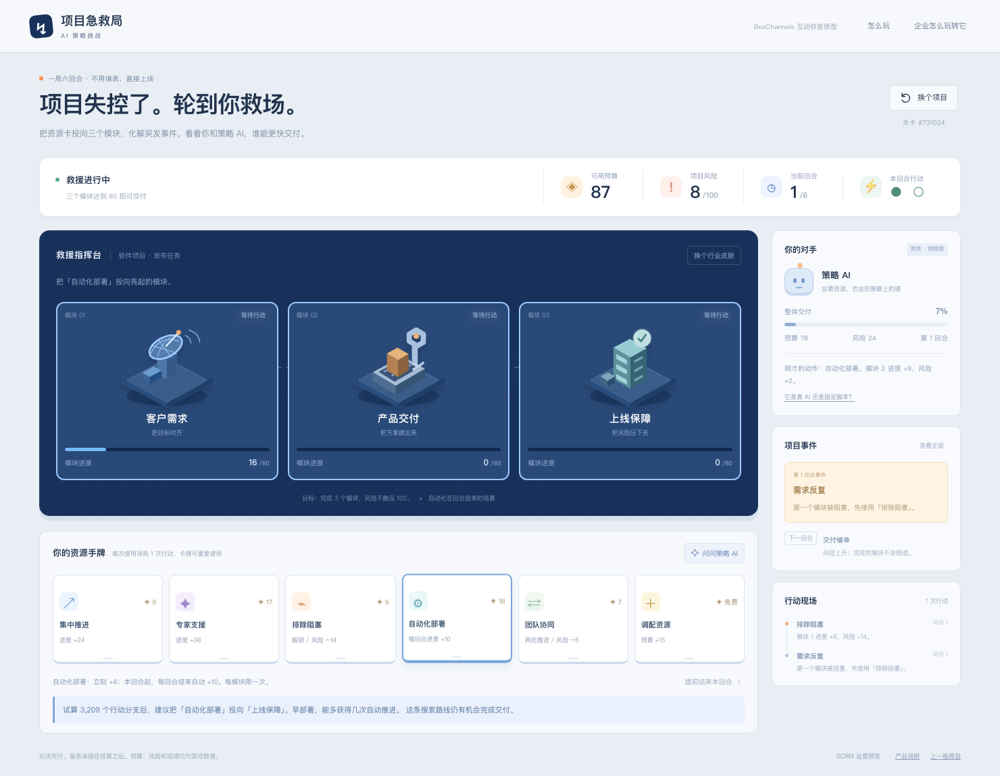

# 项目急救局 · AI 策略挑战

**[直接开玩](https://leo131496.github.io/UA_campaign/)**

拖动资源卡，在六回合内救回项目。处理阻塞、催单、预算收紧和临时返工，让三个模块达到交付目标；与实际运行的本地策略 AI 挑战同一关卡。

打开即可玩，入口没有角色、手机号、时间或描述表单。完整游戏、复盘、分享与项目清单下载均无需留资。



## 怎么玩

1. 点击“接管项目”。
2. 拖资源卡到模块，或点击卡牌后点击模块。手机和键盘也可操作。
3. 每回合有两次行动，卡牌会改变预算、进度、风险或自动化状态。
4. 三个模块都达到 80 即可交付；风险触及 100 或六回合结束仍未交付则失败。
5. 结算后可重试、查看 AI 的打法、下载复盘或复制同关挑战链接。

资源卡包括集中推进、专家支援、排除阻塞、自动化部署、团队协同与调配资源。失败可以重来，完成模块能抵御后续返工和阻塞事件。

## AI 与 SCRM

- **实际的本地搜索 AI**：在浏览器里试算行动组合，生成对手路线和成绩。教练提示会根据当前局面重新计算。没有调用大模型，有限搜索不保证全局最优。
- **同关挑战**：链接携带关卡种子与行业皮肤，好友可独立玩相同规则与事件。链接分数为自报，未经服务器校验，不是正式排行榜。
- **结算后自愿承接**：用户可以直接拿走检查清单，再自行选择是否提交业务主题、附上游戏复盘或订阅后续推荐。
- **真实接口尚未接入**：SCRM 运营预览和服务请求只在当前页面内存中模拟，不创建真实客户、不发消息、不做企微联系。游戏表现不直接推断采购意向。

软件、制造和专业服务共用同一套玩法，可更换模块名称、事件包装、清单与服务内容。

## 文档与预览

- [最新产品说明与完整规则](docs/项目急救局-产品说明.md)
- [新版验证记录](docs/项目急救局-验证记录.md)
- [手机预览](assets/项目急救局-手机.png) · [结算预览](assets/项目急救局-结算.png)
- [上版决策原型](previous/index.html) · [早期翻牌原型](legacy/index.html)
- [历史 AI 获客方案](docs/AI通用获客方案.md)

## 本地运行

无需安装前端依赖。下载仓库后打开 `index.html`，或在仓库根目录运行：

```bash
python3 -m http.server 8767 --bind 127.0.0.1
```

浏览器访问 <http://127.0.0.1:8767>。

游戏规则自检（Node.js 18+）：

```bash
node tests/engine.test.cjs
```

网站通过 GitHub Pages 从 `main` 分支根目录发布。分享游戏请使用 `https://leo131496.github.io/UA_campaign/`；GitHub 仓库地址用于看源码。

## 文件结构

```text
index.html       新版游戏入口
game/engine.js   规则、状态变更、积分与策略搜索
game/app.js      拖放、交互、AI 提示、分享与演示服务承接
game/style.css   桌面和手机界面
tests/           无第三方依赖的规则测试
docs/            产品说明与验证记录
assets/          预览图
previous/        历史决策原型
legacy/          早期翻牌原型
```

玩法是否带来有效 B2B 获客仍需真实流量验证；游戏完成量和分享入口点击不代表新增客户或成交。
