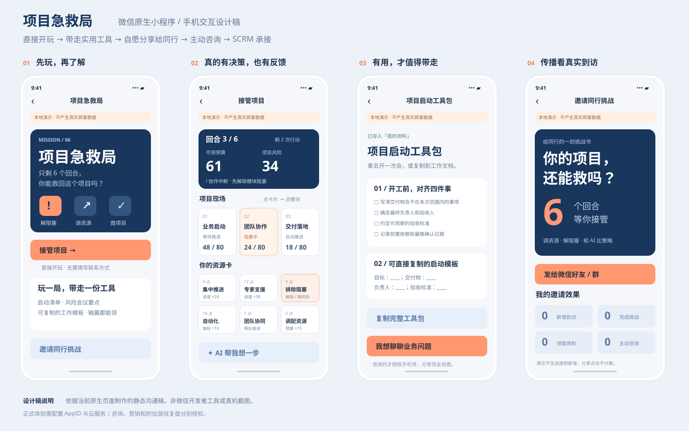

# 项目急救局 · 微信原生 B2B 活动获客

当前交付是 **微信原生小程序项目**：手机直接玩资源调度挑战，由策略 AI 提供局面建议；完成后领取实用工具包，自愿邀请同行或申请咨询，服务端记录邀请来源并向 SCRM 同步已授权的申请。

**[开发交付入口](wechat-miniprogram/README.md) · [产品与交互方案](wechat-miniprogram/docs/产品与交互方案.md) · [接口与数据说明](wechat-miniprogram/docs/接口与数据说明.md) · [开发部署与验收](wechat-miniprogram/docs/开发部署与验收.md)**



## 这次包含什么

- 七个原生页面：活动、游戏、复盘、工具包、邀请、咨询、我的资料。
- 真正可玩的六回合策略游戏，以及动态搜索下一步的本地 AI；没有调用大模型。
- 微信原生分享、活动首次到访归因、独立咨询与营销授权、主动撤回。
- 两个云函数：活动服务与 SCRM 同步；包含服务端结果校验、去重、事务、幂等和重试。
- 数据库配置、接口协议、开发交接文档及自动化测试。

目前没有真实 AppID、云环境和 BesChannels 接口，默认使用明确标注的本地演示。**尚未发布微信体验版，未产生真实获客数据。** GitHub 交付源码，微信扫码运行须由项目方取得 AppID、部署并上传体验版。

## 交给开发团队

在微信开发者工具中导入 `wechat-miniprogram/`，按其中 README 运行与部署。不要把仓库根目录的历史 HTML 当作本次小程序入口。

Node.js 18+ 下的检查：

```bash
cd wechat-miniprogram
npm test
npm run check
```

详见 [验证记录](wechat-miniprogram/docs/验证记录.md)。自动化检查覆盖规则与模拟微信接口流程，不代替原生编译、微信真机或 SCRM 联调。

## 历史原型

根目录 `index.html`、`game/`、`previous/`、`legacy/` 与早期 `docs/` 保留先前 Web 原型。GitHub Pages 仍是历史网页；当前产品方向和开发交付以 `wechat-miniprogram/` 为准。

小程序统计的活动新访客不等同于企业净新客户。SCRM 仍需联系人去重、销售跟进与真实流量验证。
