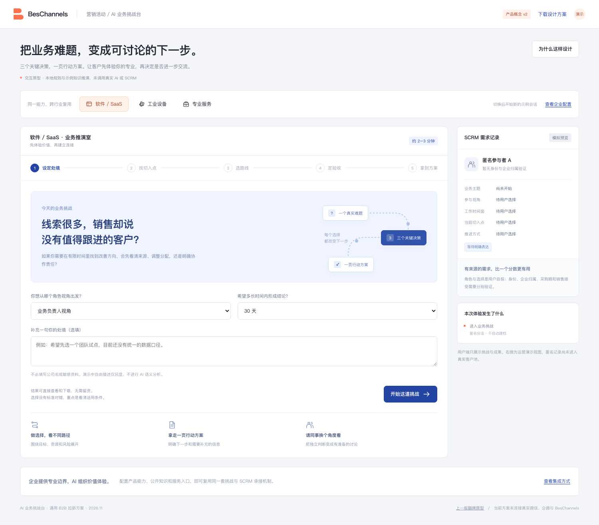

# AI 业务挑战台

面向 B2B 企业的互动获客与 SCRM 产品设计原型，拟融入 BesChannels 营销云。

用户围绕一个业务问题做三个决策，获得可下载的行动方案，比较另一种实施路径，再自愿邀请同事参与或请求顾问评审。企业可以通过同一套交互流程配置不同领域的专业内容与服务承接。

**这是交互原型：当前使用本地规则与示例材料，没有调用真实 AI、知识库、微信、企业微信或 SCRM API。**

## 运行 Demo

下载或克隆仓库后，直接用现代浏览器打开 [`index.html`](index.html)，无需安装依赖。

也可以在仓库目录启动本地预览：

```bash
python3 -m http.server 8767 --bind 127.0.0.1
```

随后访问 <http://127.0.0.1:8767>。

在 GitHub 仓库页面点击 HTML 文件会显示源码；需要下载后在浏览器打开，或另行配置静态网站托管。本仓库上传不代表已经启用 GitHub Pages。

## 可体验功能

- 软件／SaaS、工业设备、专业服务三种行业示例。
- 角色视角、工作时间窗口与可选业务背景。
- 三轮业务决策，以及随选择变化的行动方案。
- 替代路线比较、取舍说明与示例知识依据。
- 行动方案下载、可编辑的同题邀请文案。
- 独立匿名参与者的协作模拟。
- 按用户选择共享需求摘要与背景，模拟 SCRM 服务交接。
- 桌面与手机布局。

建议体验顺序：选择行业 → 开始挑战 → 完成三个决策 → 查看另一种路径 → 下载方案 → 预览邀请 → 模拟协作 → 选择交给顾问的内容。

页面状态仅保存在当前页内存，刷新会清空。自由输入只在报告中回显，当前不做语义分析。分享不创建真实邀请链接，顾问评审不向任何真实联系人发送消息。

## 设计资料

- [AI 通用获客方案](docs/AI通用获客方案.md)：业务价值、AI 职责、行业复用、传播设计、SCRM 数据与集成建议。
- [AI 原型验证记录](docs/AI原型验证记录.md)：主要交互和屏幕适配的验证范围。
- [上一版翻牌 Demo](legacy/index.html)：保留品牌／门店与 B2B 双模板作为方向对比。
- [上一版设计方案](legacy/设计方案.md)。

## 预览



[方案与承接预览](assets/AI业务挑战台-方案与承接.png) · [手机预览](assets/AI业务挑战台-手机.png)

## 文件结构

```text
index.html     最新版 AI 业务挑战台，样式与脚本内置
docs/          最新版产品方案与验证记录
assets/        最新版预览图片
legacy/        上一版翻牌原型及配套资料
```

真实上线还需接入经审核的企业公开知识、模型服务、用户身份、授权、SCRM API 和业务回调。现有界面、菜单及接口说明均为设计建议，不代表目标系统已经提供或完成这些能力。
