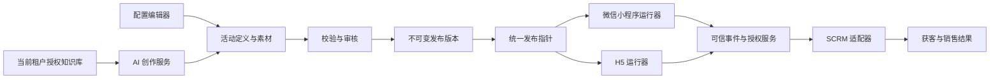

# SCRM 小游戏活动生成平台：两套设计方案

日期：2026-11-23。

- [方向 A：配置生成型](https://leo131496.github.io/UA_campaign/studio/?mode=config)
- [方向 B：AI 创作型](https://leo131496.github.io/UA_campaign/studio/?mode=ai)
- [图文方案说明](https://leo131496.github.io/UA_campaign/studio/guide.html)

## 目标与设计理念

产品是嵌入 BesChannels 营销活动模块的小游戏生产与运营能力。企业是创建者；客户是游戏参与者。通用性来自玩法、内容、素材、品牌、权益和客户承接的解耦，不依赖某个固定小游戏或行业故事。

客户页面只呈现游戏、邀请和自愿了解品牌。企业后台提供创作、配置、发布、版本、获客结果。客户不承担业务启动、项目管理或运营填表。

“所有行业”应理解为允许任意行业自定义活动内容、企业资料与承接，不应理解为所有玩法天然适合全部行业，或游戏参与一定带来采购线索。制造、软件、教育、健康、金融、零售和文旅只是起始内容包；企业还可以维护自己的包。

## 方向 A：配置生成型

**核心路径：选择引擎 → 配置内容 → 设定分享 → 权益与承接 → 双端预览 → 确认发布。**

### 设计稿页面

1. 左侧保留 SCRM 的营销导航，当前模块为“小游戏工坊”。
2. 顶部选择生成方式，A/B 各自保留草稿，避免切换时混淆。
3. 中间展示三个真实不同的引擎：记忆翻牌、目标收集、知识闯关。
4. 配置分为品牌内容、玩法分享、权益与 SCRM；右侧展示可实际操作的手机预览。
5. 小程序 / H5 切换展示不同外观，同一活动定义驱动客户内容。

### 配置范围

| 配置 | 对生成游戏的影响 |
| --- | --- |
| 引擎 | 改变操作、反馈、计分和结束条件，不能只换标题 |
| 行业包 | 预置品牌、元素、配色、题库和权益示例 |
| 自定义行业 | 不受预设列表限制，允许编辑行业名称与所有内容 |
| 内容与题库 | 替换卡牌/目标名称；问答编辑题目、3 个选项、答案和解释 |
| 品牌 | 名称、主色、标题、介绍；正式版增加 Logo 和素材上传 |
| 时长 | 30 / 60 / 90 秒，实际影响倒计时与结算 |
| 分享关系 | 同关成绩挑战或自由分享；无强制分享解锁 |
| 权益 | 名称、库存、说明、适用条件、履约入口；库存需服务端交易扣减 |
| SCRM | 主动了解主题、兴趣标签、分配规则、渠道与来源归因 |

适合活动重复生产、跨品牌复制和区域运营。它的价值是可靠、可控、低制作成本；不必每次重新写程序。

## 方向 B：AI 创作型

**核心路径：输入活动想法 → 澄清缺项 → 生成结构和内容 → 试玩 → 对话修改 → 确认发布。**

### 设计稿页面

- 左侧需求输入：目标受众、活动场景、玩法偏好、时长、视觉方向、权益。提供制造展会、教育和零售三个例子。
- 中间方案卡：活动标题、推荐引擎、参与—分享—承接三个步骤、素材来源和待确认项。
- 右侧客户预览：由生成结果驱动同一个游戏运行器。
- “继续修改”支持本稿示例范围内的引擎、行业预设、配色、时长；引号可指定品牌和活动标题。
- “调整生成内容”允许人工编辑；可复制至配置型草稿继续修改题库和承接。
- 超出组件库的需求会明确显示能力缺口，例如实时多人、3D 赛车，不虚构已生成。

### 正式 AI 的职责

1. 根据目标选择玩法与传播关系，输出可核对的原因。
2. 检索当前企业允许公开的资料，生成有引用的题目、故事、标题、规则说明。
3. 按品牌规范生成或组合素材。生成图片属于单独异步任务，标注来源、版权授权状态和审核结果。
4. 生成结构化活动配置；按用户修改计算配置差异并保留版本。
5. 给出可玩性检查结果、发布缺项和成本估计。

客户可以玩到多变的内容、关卡与主题。玩家端 AI NPC、共创出题、个性化内容是可新增的玩法组件；企业侧 AI 创作无需在每次游玩时调用模型。这样能控制时延与按次成本。

**当前实现边界：本设计稿的 AI 使用明确标示的关键词/示例解析器，并未连接大模型。自由文本中超出示例规则的要求不会自动完整落实，生成后必须核对；不能把当前解析器当成模型能力。**

## 共用架构与自动同步

### 活动定义建议

| 区域 | 主要字段 |
| --- | --- |
| 标识 | tenantId、campaignId、draftId、releaseId、schemaVersion |
| 引擎 | engineId、engineVersion、supportedClients、minimumRuntimeVersion |
| 内容 | title、brand、theme、assetRefs、questions、levels、sourceRefs |
| 规则 | duration、difficulty、scoringVersion、shareMode、playLimits |
| 权益 | benefitId、stockPolicy、eligibility、fulfilment、validity |
| 承接 | consentVersion、serviceTopic、marketingOptional、fieldMapping、assignmentRule |
| 生成记录 | prompt、modelVersion、sourceVersions、generationJobId、reviewer |
| 发布记录 | immutableSnapshot、hash、publishedBy、publishedAt、status |

小程序先上线稳定玩法组件，发布活动时加载审核后的参数、文案和素材。两个运行器支持相同活动定义并共用服务端计分和权益验证。已有组件配置可自动同步；新增可执行组件需要开发与微信审核，不做远程任意代码执行。

进入游戏时固定 releaseId；完成、权益、邀请等事件均携带它。发布新版本不改变进行中的对局。回滚改变当前发布指针，不删除历史用户、成绩或领取记录。

本设计稿使用不可变 URL 配置快照演示 H5 发布，A/B 各自保留发布列表和当前版本。此类链接自包含，无法远程撤销。正式实现须改为服务端活动 ID / 发布指针和有效期；不能把快照链接直接作为生产活动链接。

## AI 服务接入口（建议契约，不是现有 BesChannels API）

| 动作 | 建议输入 / 输出 |
| --- | --- |
| 创建生成任务 | 当前租户、活动目标、prompt、允许素材引用、能力清单、预算；返回 jobId 与状态 |
| 查询生成结果 | 返回 plan、campaignDraft、sourceRefs、warnings、capabilityGaps、cost |
| 提交修改 | 基于 draftVersion 与用户意图生成 diff，不覆盖新版本草稿 |
| 校验活动 | 结构、范围、答案一致性、素材可用、游戏可结束、权益和授权 |
| 发布 | 审核人确认指定版本；幂等写入不可变 release 并推进指针 |
| 回滚 / 暂停 | 校验租户权限，记录操作，更新指针或活动状态 |

后端托管模型密钥，租户隔离知识与素材。模型连接可以采用腾讯混元、DeepSeek 或企业自建服务，配置供应商、模型 ID、密钥引用、超时和限额。模型不能决定微信身份、权益核销、客户去重或真实计分。

生成需要内容审核、事实依据、参数校验、可玩性检查；玩家原始个人信息不放入模型提示。长任务异步、支持取消与重试；错误时保存草稿并标明未完成部分，不能假装发布成功。

## SCRM 接入与价值衡量

建议嵌入位置：营销活动 → 小游戏工坊。复用现有企业租户、权限、活动 ID、素材、客户身份、标签、分配与旅程。真实入口位置和接口需依据 BesChannels 实际提供的能力调整；本轮没有访问或修改其生产/测试后台。

| 阶段 | 记录 | 是否有效线索 |
| --- | --- | --- |
| 访问 / 开始 / 结束 | 匿名参与者、渠道、邀请关系、活动版本 | 否 |
| 分享点击 | 分享意图，不保证发送或带来新人 | 否 |
| 好友真实进入 | 服务端去重来源，排除自邀与重复 | 否 |
| 领取内容 | 领取与履约记录 | 仍不自动视为采购意向 |
| 主动申请 | 验证身份、明确主题、授权版本与时间 | 待资格确认 |
| SCRM 净新联系人 | 与历史客户身份去重 | 新联系人，不等于有效商机 |
| 销售确认 | 需求、客户适配、后续动作及退回原因 | 按企业口径确认 |
| 商机 | 商机阶段与归因窗口 | 单独统计，不混同游戏转化 |

访客不需要先留手机号。主动申请的服务授权与后续营销授权分离，不默认勾选。不能用游戏分数、反应时间或发现顺序推断职位、预算、采购需求。

效果验证：制作时间、单活动成本、完成率、真实邀请到访率、净新联系人、销售接受率、新增有效线索成本、商机转化。与同渠道、相似受众的原有活动进行对照，并记录投放和权益成本。数据未接通时展示未知，不预填“增长 200%”等承诺。

## 当前交付与验收

本轮请求是“两方向设计稿”，交付为可交互后台原型与浏览器手机玩法。没有声称完成新平台的微信原生运行器、真实 AI、图像生成、上传审核、SCRM 对接、服务端活动发布或正式权益履约。

已有 `wechat-miniprogram/` 为上一版原生找茬代码，仍保留供参考；本轮三个新引擎不能直接当作它已经具备的原生功能。

可验收路径：

1. A 切换任一行业，自定义品牌与游戏内容；切换三种玩法，观察实际交互变化。
2. 完成任一游戏，发起同关挑战；在独立页面测试朋友视角。
3. B 输入示例需求，生成方案、继续修改、人工调整，复制到 A 深度编辑。
4. 输入 3D 赛车等不支持能力，确认显示能力缺口。
5. 发布演示版本，打开独立 H5；修改草稿再发布，恢复上一版本。
6. 在客户页面自愿模拟申请，后台看到当前浏览器的真实演示事件；净新客户与商机仍显示待接入。

后续开发建议先交付 A 与统一活动定义，再让 AI 生成同一种定义，避免维护两套游戏系统。真实模型与行业知识接入后，B 才具备任意自然语言创作能力；是否达到可发布质量必须单独验收。
