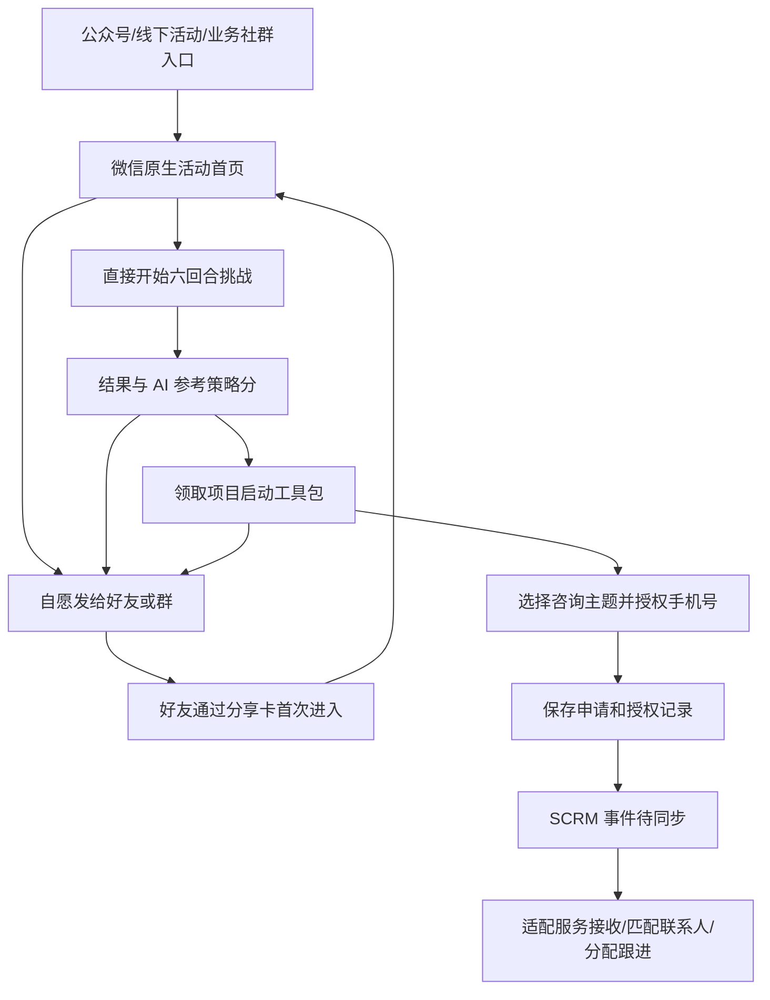

# 项目急救局：把业务问题变成一次可以玩的挑战

## 1. 产品判断

采用**微信原生小程序中的轻策略游戏**。不是填完问卷再出结论：用户一进入就面对一个出问题的项目，用有限预算、资源卡和六个回合救回交付。用户可以独立玩完、拿走工具，再决定是否邀请同行或申请咨询。

它解决 B2B 获客链路的三个问题：有趣的入口让用户愿意停留；实用工具包让活动与工作有关；咨询主题与用户主动授权，让销售得到可以开口的上下文。它不能单靠游戏识别决策人、判断预算或保证成交。

## 2. 与常见抽奖、翻牌、答题活动的差别

| 设计点 | 本方案 |
| --- | --- |
| 用户做什么 | 真正调度资源，看到预算、进度、风险和自动化的连锁变化 |
| 再玩一次的理由 | 改变打法、尝试避开事件，与 AI 参考策略比较 |
| AI 参与方式 | 根据当前局面搜索后续行动，给出下一步；不是预先写死的“你适合某产品” |
| 分享动机 | 给同行发一张工作场景挑战卡，有讨论价值；没有强制助力或拉人开锁 |
| 企业承接 | 领取工具包后，自愿选择实际问题申请咨询；记录来源、主题与授权 |
| 通用性 | 规则不依赖某一品牌，运营方替换模块名称、工具内容、服务主题即可复用 |

首版 AI 为本地 beam search：提示搜索宽度 24，同关参考宽度 48。它尝试可行动作、评估剩余资源和完成机会，有搜索上限，不保证最优。当前不包含大模型问答、生成式报告或采购意向预测。

## 3. 手机端完整流程

| 手机页面 | 用户看到什么 | 核心操作与反馈 |
| --- | --- | --- |
| 活动首页 | “只剩六个回合，你能救回这个项目吗？” | 直接接管项目；看资料价值；不填前置表单 |
| 游戏现场 | 三个模块、预算、风险、资源卡 | 先点卡再点模块；错误动作说明原因；每回合两步 |
| 结果复盘 | 成败、得分、同局面 AI 参考分 | 无论输赢都可领取；再玩；自愿邀请 |
| 工具包 | 清单、会议要点、可复制模板 | 直接阅读和复制；资料存入“我的资料” |
| 邀请同行 | 原生分享入口、个人邀请效果 | 发微信卡片；不展示好友手机号或身份 |
| 主动咨询 | 三个主题、信息说明、独立可选授权 | 微信授权手机号；附复盘/接收推荐均默认不选 |
| 我的资料 | 资料、申请状态、营销授权 | 刷新状态、查看资料、撤回后续推荐 |

布局按手机竖屏设计，采用原生导航和底部“活动 / 我的资料”。主操作使用至少 88rpx 点击区；触摸选卡，无需拖拽精度。游戏离开后在两小时有效期内恢复本机进度。重复点击提交、领取或咨询不会重复创建权益或申请。

### 游戏规则

- 初始预算 96、风险 22；三个模块都达到 80 即交付成功。
- 六回合，每回合两次行动；可以主动结束回合，等待自动化运行。
- 资源卡：集中推进、专家支援、排除阻塞、自动化部署、团队协同、调配资源。
- 事件：需求反复、催单、协作中断、预算收紧、临时返工、最后冲刺。
- 风险达到 100，或六回合结束仍未交付，则失败。失败仍能领取工具包。
- AI 提示先选中建议卡，玩家仍需自己决定是否执行；不会替用户自动完成挑战。
- 客户端上传每一步行动，云端重新计算结果；客户端自报分数不起作用。

### 视觉方向

深蓝项目控制台、珊瑚色主要动作、浅蓝策略提示、绿色完成状态。现场模块与资源卡保持清楚的先后关系，优先让用户知道“现在能做什么”。活动页、游戏页、邀请页采用同一组颜色，便于替换企业品牌。`界面设计稿.svg` 为静态设计沟通稿，不能代替微信真机验收。

## 4. 面向不同 B2B 企业复用

| 企业类型 | 三个模块的包装 | 可交付的工具包 | 自愿咨询主题例子 |
| --- | --- | --- | --- |
| SaaS / 企业软件 | 业务启动、协作流转、交付落地 | 实施启动清单 | 流程梳理、跨团队协作、实施效率 |
| 工业制造 / 设备 | 需求确认、产线协同、验收交付 | 项目验收清单 | 产能规划、设备协作、交付风险 |
| 专业服务 / 咨询 | 问题界定、方案执行、结果验收 | 项目范围与变更模板 | 范围确认、资源配置、验收标准 |

代码中品牌、三个模块名、资料内容、咨询主题、活动日期与客服入口都由活动配置提供。事件文案目前是通用项目事件；行业深度定制时须同时更新客户端与云端的同一版规则，并跑一致性检查。

## 5. 企业究竟获得什么

1. **可追踪的活动触达**：知道哪些活动参与者带来后续新访客，不把分享点击算作传播成功。
2. **有内容价值的互动**：用户拿到能在工作中使用的材料，企业获得一次有主题的品牌接触。
3. **主动咨询机会**：提交人选择具体问题，并明确授权本次联系；销售获得主题、活动来源、授权时间。不会默认收到游戏复盘。
4. **可继续经营的数据**：SCRM 根据真实联系人去重，区分现有客户互动和净新线索，按授权范围安排跟进。

“工具包领取者”是活动参与者，不自动创建为可营销联系人。只有主动咨询且取得手机号授权，才进入待跟进联系人流程。销售资格认定仍需后续了解企业、岗位、需求与项目阶段。

## 6. 拉新如何运营与衡量

起量由企业已有公众号、销售社群、线下展会或合作渠道导入第一批用户。当前代码支持原生微信好友/群分享；公众号入口配置与线下小程序码生成需在拥有 AppID 后由运营配置，不在本次代码中伪造。

首版按**活动内 OPENID 首次到访**记录归因，第一次来源固定；自己分享给自己、重复打开、已有参与者后来收到邀请，均不增加该邀请人的新增到访。邀请码绑定服务端邀请人，客户端不能指定别人的身份。

| 指标 | 计算口径 |
| --- | --- |
| 活动新访客 | 本活动第一次被服务器记录的微信用户，按 OPENID 去重 |
| 邀请新增到访 | 以上用户首次到访携带有效非本人邀请码 |
| 挑战完成率 | 独立完成人数 / 独立到访人数，成功和失败均算完成 |
| 资料领取率 | 独立领取人数 / 独立到访人数 |
| 主动咨询率 | 独立咨询人数 / 独立到访人数 |
| 企业净新线索 | SCRM 对手机号/已有关联标识去重后，由业务规则确定；不由小程序自行宣称 |
| 销售有效率 | 人工或 SCRM 流程确认的有效线索数 / 主动咨询数 |

运营试点建议选择一个已有流量渠道，先验证“玩得懂、愿意完成、资料有用”，再比较不同工具包的咨询转化。游戏活动与普通资料页可做对照，比较每条有效线索成本。没有流量和真实试点数据，不能承诺裂变倍数或成交提升。

## 7. 融入 BesChannels 的方式

目标系统为用户提供的 `https://beschannels-stg2.ma.scrmtech.com/dashboard`。当前没有其接口文档与登录条件，因此这里是集成设计与可运行的发送端，不声称已接入厂商接口。

建议在现有系统“营销活动”下增加“互动挑战”配置：选择模板、品牌、资料、咨询主题、期限、活动归属和跟进负责人。该管理入口本次只提供字段与交互规格，不重做一个独立 Web 后台。

- 发布：审核活动配置，生成小程序页面路径；后续由已认证主体生成小程序码。
- 看板：从活动总计读取到访、完成、领取和主动咨询；真实净新联系人由 SCRM 计算。
- 联系人：按微信开放标识映射或已验证手机号匹配；写入“咨询主题、活动来源、服务授权”，可选写入游戏复盘。
- 跟进：根据咨询主题、组织/区域路由分配负责人。活动参与与营销授权分开处理。
- 异常：展示同步积压、重试与失败事件，允许修复配置后幂等重放。

## 8. 本次范围

交付七个原生页面、游戏规则、搜索 AI、演示数据服务、两个云函数、数据库示例、测试和交接文档。尚需真实 AppID 和微信开发者工具编译/真机验证；云开发、手机号、企业微信客服和 BesChannels 的真实联调均待项目方提供条件后执行。

微信分类、主体权限与提审要求由项目方结合实际运营内容确认。本项目技术类型为 `miniprogram`，不是独立 `game` 类型的小游戏引擎工程。
